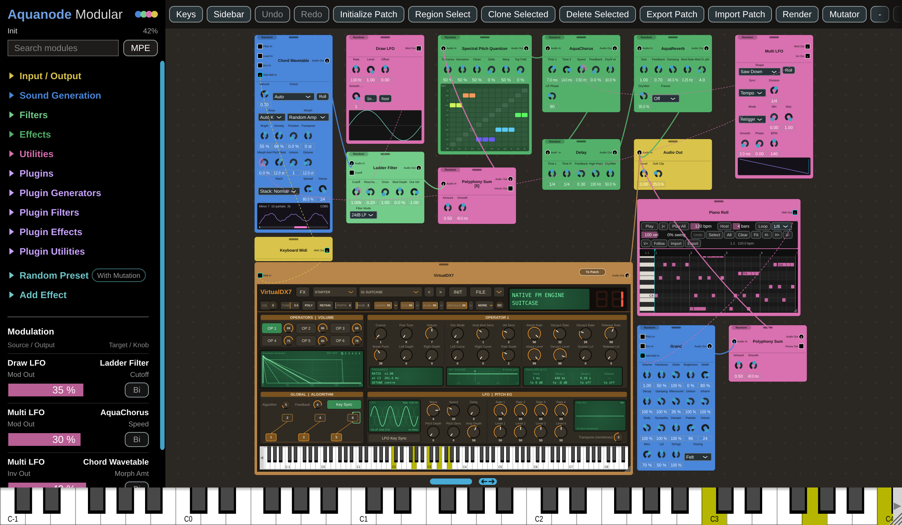

# Aquanode Modular

Download builds from the [Releases](../../../../releases) page. Current version: 5.15.0.

---

## Overview

**Aquanode Modular** is a free modular synthesizer for Windows (VST3 plugin and standalone `.exe`) and Android, with an effect version, **Aquanode Modular FX**, precompiled as a Windows VST3. The full JUCE/C++ source code is in this repository and can be compiled for any platform JUCE supports. It was created with the assistance of Claude, the AI by Anthropic.

**This version of Aquanode Modular is the main one and contains many updates over the one in my** *aquanode-plugins* **repository. Some of the enhancements in this version include:**
- VST3 import using the VST3 module (not in the Android version, as VSTs are not compatible with Android),
- MPE capability,
- more of my plugins from the aforementioned repository pre-included in the Plugins section of the sidebar,
- new plugins like Tidebreeze, a ROMpler-inspired synthesizer,
- a 303-style bass line synth fitted to recordings of the original hardware,
- the Vita plugin, a port of Vital, updated, cleaned, and even available in the Android version,
- a module search bar,
- more designs and colourways,
- plugin window and graphic piano roll resizing,
- more random presets,
- new physical modelling pianos and more modules in general.

### No Copyrighted / Non-Open Source Material

**A few of these plugins are more or less obviously modelled after other third-party synthesizers, but no reverse engineering or similar happened in the making of Aquanode Modular - only measurements and by-ear finetuning of the modules.**

---

## About

Inspired by classic hardware and digital modular environments, Aquanode Modular is an experimental playground to place modules, drag patch cables, and build complex sounds out of simple blocks. Other synthesizers and effects of mine, such as Phizmo or VirtualDX7, are built in as plugins, each playable with its own interface or taken apart into modules.

It works entirely offline without update checks, sign-in or downloaders. The Android app doesn't even ask for the internet permission.

### Features

- Currently **143 modules** (142 on Android since it has no VST3 import module), from simple utilities to FFT spectral processors, physically modelled pianos, a resynthesized piano and an impulse-response forge.
- **27 built-in plugins**, each usable as its original interface on one card or as a patch of its own modules.
- **Feedback routing:** real audio feedback loops, down to an oscillator modulating itself. Careful, loops can get loud fast.
- **Random patches:** one tap builds a new patch of a category (Bass, Pad, Pluck, Chord, Bell, FM ...), and the **Mutator** varies and breeds patches.
- **MPE**, **microtuning** (MTS-ESP) and **render to file** (WAV or FLAC, faster than real time).
- **Self-contained patches:** `.aqua` files hold the routing, positions, colours and all loaded audio.
- **Your colours:** every part of the interface and every module card can have its own colour, plus a skeuomorphic hardware look.
- A zoomable patch area (10-200 %) and a resizable window.

---

## Quick Start

1. Open **Sound Generation** in the sidebar and add an **Oscillator**.
2. Add an **Audio Out** from **Input / Output**. Nothing is heard without one.
3. Drag a cable from the Oscillator's round **Audio Out** socket to the Audio Out module's **Audio In**.
4. Play your MIDI keyboard or the on-screen keys.

**Initialize Patch** in the top bar builds this for you (Oscillator → Polyphony Sum → Audio Out), and the **Random Preset** section at the bottom of the sidebar builds complete patches.

---

## Using It

### The patch area

- **Pan** by dragging empty space. **Zoom** with the mouse wheel, a two-finger pinch, or the **-** / **+** buttons; the zoom percentage under the sidebar title resets the view when tapped.
- **Sidebar** and **Keys** in the top bar hide the sidebar and the on-screen keyboard. Drag the blue grip above the keys to change their height, and pinch the keys (or Shift + drag) to change their width.
- **Drop to patch:** drop a module onto a fitting cable and it's inserted in between (an effect on an audio cable, an Arp on a MIDI cable). Drop it onto another module and the obvious connection is made: a source into Audio Out, an envelope into Env In, an LFO into a filter's cutoff, a modulation source onto a knob, and so on. Whatever would be connected lights up while you drag.

### The sidebar

- Categories: Input / Output, Sound Generation, Filters, Effects, Utilities, then **Plugins** and the modules the plugins can be taken apart into, then **Random Preset** and **Add Effect**. Inside a category, modules are grouped by what they do.
- **Search** lists every module and plugin matching a name, group or description. Rest the pointer on a module's name to read its description.
- Click once to add a module (tap twice on a touch screen, so scrolling never adds one by accident).
- **MPE:** with the switch beside the search on, every finger on the on-screen keys (or every note from an MPE controller) is its own note: slide sideways to bend it, up and down for its Slide (CC 74), with pressure where the screen reports it. The **MPE** module from the sidebar turns each note's Slide, Pressure and Bend into cables.

### Cables and modulation

- Round sockets carry audio, square ones modulation, rounded squares with a cyan ring MIDI. Inputs are on the left, outputs on the right. One output can feed many inputs, and several cables into one input are mixed.
- **Feeback Routing** is possible: Drag a cable from its output into the input of the same module or earlier modules, creating a loop which can have unpredictable effects (mostly very loud ones, so please use limiters).
- **Any knob can be modulated:** drag a cable from an output onto it. A new knob cable starts at 25 %; right-click or hold the knob to change its amount, switch **Bipolar** (swing both ways around the setting) or remove it. The ring around a modulated knob shows how far it can move. The **Modulation** table at the end of the sidebar lists every knob cable with its amount.
- **Reroute Send / Return** carry audio across the patch on eight buses without a visible cable.
- Click a cable twice to delete it, or select a module or cable and press Delete. Triple-click a module to clear its self-feedback cables.

### The top bar

- **Undo / Redo**: 32 steps (Ctrl+Z, Ctrl+Shift+Z / Ctrl+Y).
- **Initialize Patch**: the default patch (in the FX version, Audio In → Audio Out).
- **Region Select**: drag a box to select several modules, then move, **Clone** or **Delete** them together. **Clone Selected** and **Delete Selected** also work on a single module.
- **Export / Import Patch**: `.aqua` files. Inside is a zip with a plain, readable `patch.xml` and every sound as a file of its own in a `samples` folder.
- **Render**: plays the patch's Piano Rolls into a WAV or FLAC file (24-bit, 44.1-96 kHz) while you keep playing. The file lasts as long as the longest roll, plus the tails.
- **Mutator**: varies the knobs by an amount you choose (never the cables or the output level), stores two variations A and B and breeds them. Each card also has its own **Random** button that mutates only that card and can be reverted.

### Colours

Tap **Aquanode Modular** at the top of the sidebar for the colour panel: the backgrounds, the text, every category, three ready colourways (Cyan Blue, Sakura, Green), the grid markers and the **Skeuomorphic** look (smooth panels, glass sockets, silver knobs, small CRT screens). Right-click or long-press a module's title to give that card a colour of its own. Patches carry their colours.

### Microtuning

Aquanode Modular is an MTS-ESP client. While an MTS-ESP master runs, every pitched module plays its scale, live, and the scale's name shows at the top of the sidebar; keys the master leaves out are silent. VirtualDX7 follows the master with its own client, and the other plugins keep their own tuning. There is no MTS-ESP on Android.

### Tips

- **Shape the volume:** an **ADSR** into an oscillator's **Env In**. Without one, the oscillator drones while a key is held.
- **FM:** one Oscillator's Audio Out into another's **FM In**. For FM that fades out naturally, feed one ADSR into both Env Ins. Each **VirtualDX7 - Operator** is a full DX7 operator, so any DX algorithm can be patched by hand.
- **MIDI streams:** every module with a Midi Out (Piano Roll, Arp, Midi Add, Keyboard Midi ...) is its own stream and can be chained, for example Piano Roll → Midi Add → Arp → Oscillator. Anything patched into a Midi In replaces the played keys there, and a **Discard Midi** with ALL lit keeps the keys away from a module.
- **Chords:** **Midi Add** adds up to four notes, **Graphic Midi Add** up to seven, with ready chords in its menu.
- **Drums** (Kick, Clap, Hats, Snare, Modal Drum, Pluck) play from the keys, from Trig In, or from a stream on their Midi In.
- **Sweeps:** draw a shape in **Curve CV**, set a knob to its minimum and cable the curve onto it at 100 %.
- **Controllers:** pitch bend and sustain work everywhere. **Midi Controls** turns the mod wheel, aftertouch and CCs into cables, and **Midi Learn** drives any knobs from one control of your controller.
- **Levels:** sources at their defaults peak around -6 dBFS, so a chord and a few effects have headroom. **Polyphony Sum** before Audio Out keeps chords from stacking up, and Audio Out's **Soft Clip** catches the rest.
- **Make anything talk:** a pad into **Cepstral Morph**'s Carrier and speech into its Modulator.

---

## Aquanode Modular FX

The same instrument as an effect plugin, built from the same source code. **Audio In** brings in the track's audio and the default patch is Audio In → Audio Out. Everything else is identical, and it receives the track's MIDI too, so its synth modules can still be played.

---

## Random Preset

Each row at the bottom of the sidebar is a category: **303, Arp, Bass, Bell, Chord, DAW, FM, FX, Growl, Keys, Kick, Lead, Pad, Perc, Pluck, Synth** and **Random**. A tap replaces the patch with a newly built one of that category, different every time. The result is an ordinary patch you can edit, export and mutate.

The patches come from several engines, picked at random per tap: genre engines (Ambient, Atmospheric DnB, Colorbass, DnB, Dub Techno, Psychill, originally from presets I made by hand for Vital or DX7 clones) that build sounds from Aquanode modules, Slow FM pads and bells from VirtualDX7 operators, the Tidebreeze and Phizmo plugins with a freshly rolled preset, a self-playing Pol Sweep patch, and other hand-made presets.

- **FM** builds a 6-operator DX voice laid out like the DX7's algorithm chart; its menu picks a sub-category or loads any DX7 SysEx file.
- **303** builds an acid patch: a mono saw or square through a screaming ladder filter, or the 303 module, sometimes playing a hook of its own.
- **Arp** patches start arpeggiated, and **Growl** builds spectral or random-morph growls.
- **DAW** is an empty two-track arrangement to draw into and render.
- **With Mutation**, beside the section title, also mutates every generated patch three times.

**Add Effect** adds to the loaded patch instead: a chord in front of every synth, or reverb, delay, modulation, spectral or colour effects in front of Audio Out.

---

## Plugins

The **Plugins** section holds my other instruments and effects, built in. They work in the synth, the FX version and on Android.

- **Synths:** AliasSynth, Aquanova, Aqua Vibrio, AlphaBeta, CombWeave, Cove Groove, GrainFreeze, NoteAdder, Phizmo, PhizmOsc, SampleField, Slicer, Soundscape Ecology, Tidebreeze, VirtualDX7.
- Additionally, it contains Vita, a port of Vital without the Vital branding (as intended by the original developer when reusing their code).
- **Effects:** 83ChorusVerb, AlphaBetaFX, AutoMorphEQ, CenterComb, FlowEQ, FullFilter, Phorest, PrecisionUtility, Resonate, TapElectric, Vocode.

Every plugin can be added two ways:

- **GUI:** the original plugin with its whole panel on one card, its own presets and file loading, and Midi In (plus Audio In where it has one).
- **Patch:** the same instrument taken apart into modules named *Plugin - Part* (*Phizmo - Voice*, *Vita - Osc* ...) and wired as the plugin is inside. They run the plugin's own engine, so it sounds the same, but you can re-patch it, modulate any knob or put other modules in between. A GUI card's **To Patch** button converts it, keeping its sound.

Synth plugins play from the keys unless something is patched into their Midi In; effect plugins only take notes from their Midi In. Sounds a plugin loads (samples, wavetables, user waves) are saved inside the patch, so it plays the same on another computer or phone. The plugins never create files or folders on their own.

A few notes on individual plugins:

- **Aquanova** is a loose Supernova-style synth, **Aqua Vibrio** a close Virus/Viper-style one. Aqua Vibrio's *Original* engine loads `.mid` / `.syx` and `.fxb` banks and can use a folder of the hardware's sampled waves.
- **AlphaBeta** is my tribute to LinPlug's **Alpha 3**: its liquid filter and chorus, and an Original engine modelled on FreeAlpha 3.3. LinPlug is no longer around - still, thank you for a wonderful synth.
- **Tidebreeze** is a 2000s ROMpler-style synth whose waves are all generated, not recorded: 35 factory waves (airy voices, flutes, strings, bells, organs, surf, whale song ...), 39 presets, two layers, an arpeggiator and 17 effects. **ROLL** rolls new presets by category, **ROLL WAVE** new waves, and **LOAD FILE** turns your own audio into a wave.
- **Cove Groove** generates noisy hardgroove loops: eight drum lanes with ten fitted sounds each plus your own samples, five groove styles, GENERATE / RND, 30 presets, kits, and a phaser, moving band-pass, delay and drive. It follows the DAW's transport or runs on its own tempo.
- **Phizmo**'s logo (or its RANDOM badge) rolls presets in eight styles.
- **Vocode** is a filter-bank vocoder with up to 256 bands; **Width** goes from narrow ringing bands to wide washy ones.
- **Resonate** keeps the tuning when you switch between its four engines.
- **Vita** is adapted from the Vital synthesizer by Matt Tytel and used under the GNU GPL. It knows only the presets and banks you load into it, and can keep its library inside the patch.

---

## Module List

Click on the text for the full dropdown list!

<strong>All 143 modules by category</strong>

| Category | Module | Description |
| :--- | :--- | :--- |
| Input / Output | Audio In | The host's audio input, with a level knob. |
| Input / Output | Audio Out | The patch's output, with Level and Soft Clip, an oversampled soft limiter that never passes 0 dBFS (off in the FX version). |
| Input / Output | Keyboard Midi | The notes you play as a cable, for a drum's or Droplets' Midi In. |
| Input / Output | Midi Controls | Pitch bend, mod wheel, aftertouch, any CC and the sustain pedal as cables; sets the bend range. |
| Input / Output | Midi Learn | One control of your MIDI controller driving any knobs across their range, like a Macro. |
| Sound Generation | 303 | Bass line synth fitted to recordings of the original hardware. Plays from MIDI (Free, Mono with slide, Poly) or its own 1-4 bar pattern grid, with RANDOM hooks (arps, octaves, acid lines, ambient drifts). |
| Sound Generation | Additive | Draw up to 64 harmonics, shaped by Tilt, Odd/Even and Stretch. |
| Sound Generation | Analog Drift | The FM Oscillator with per-voice drift, random phases and up to 7-voice unison. |
| Sound Generation | Bowed | Physically modelled bowed or blown string that sustains while a note is held. |
| Sound Generation | Chord Wavetable | Generated chord wavetables with 16-voice chord-stacked unison and spectral morphs. |
| Sound Generation | Clap | Analog clap from three noise bursts and a tail. |
| Sound Generation | Complex Osc | West Coast-style FM into a wavefolder, no filter. |
| Sound Generation | Droplets | Random sine pings following real bubble acoustics. |
| Sound Generation | Dual VCO | Two VCOs and a mixer, panel-style. |
| Sound Generation | Formant | Singing oscillator morphing through the vowels A-E-I-O-U. |
| Sound Generation | Grand | The piano model as a concert grand with sympathetic strings, mics and lid, in two voicings (Felt, Clear). |
| Sound Generation | Granulator | Granular sampler with a cloud of pitched grains per note; Grain Atk / Rel shape each grain's fade. |
| Sound Generation | Hats | Analog hi-hats from six detuned squares; Decay goes from closed to open. |
| Sound Generation | Kick | Analog kick with a pitch-drop envelope and drive. |
| Sound Generation | Modal Drum | Physically modelled percussion, from marimba to bell. |
| Sound Generation | Noise | White or pink noise per voice. |
| Sound Generation | Oscillator | The core polyphonic FM operator with FM In and Env In. |
| Sound Generation | Phase Distort | Phase-distortion oscillator; DCW morphs the wave without moving the pitch. |
| Sound Generation | Piano | Real-time physical piano model in three voicings: Felt, Mid and Hard. |
| Sound Generation | Pluck | Karplus-Strong plucked string. |
| Sound Generation | PWM Osc | Polysynth VCO with PWM and a square sub-oscillator. |
| Sound Generation | Resynth Piano | A piano rebuilt from 33 recorded notes as partials, hammer samples and noise (no recordings inside, 1 MB). |
| Sound Generation | Sampler | Keyboard-mapped sample player with a zoomable waveform. |
| Sound Generation | Spectral Resynthesis | A sound taken apart by the FFT and played from the keys: time-stretch, freeze, and spectral editing by region or by note, drawn on its spectrogram. |
| Sound Generation | Snare | Two shell tones and a noise burst for the wires. |
| Sound Generation | Transwave | Wavetable oscillator generated from a seed and one of twelve archetypes. |
| Sound Generation | Unison | Up to nine detuned, panned copies of a note. |
| Sound Generation | Warp Osc | Band-limited morphing oscillator with seven phase warps, 16-voice unison and a Random Amp spectral morph. |
| Sound Generation | Wavetable | Scans a sample as single-cycle frames. |
| Sound Generation | Wind | Physically modelled flute, pan flute and clarinet. |
| Filter | 3-Bell EQ | Three bells on a draggable curve. |
| Filter | AquaFilter | Saturating ladder and SVF in several modes. |
| Filter | Bell | A single peaking band. |
| Filter | Center Comb | Peaking filters spread around a centre frequency. |
| Filter | Comb Filter | Delay-line comb that rings at a pitch. |
| Filter | Dual Filter | HPF into LPF with self-oscillating peaks. |
| Filter | Formant Filter | The vowel bank applied to any audio. |
| Filter | Highpass | 12 or 24 dB highpass. |
| Filter | Ladder Filter | Transistor-ladder filter with drive. |
| Filter | Lowpass | 12 or 24 dB lowpass. |
| Filter | Notch | Narrow band cut. |
| Filter | Pitch Lock Filter | Dampens every note not in the chosen pitch classes. |
| Filter | Resonance Suppressor | Finds and cuts resonances as they happen, with no latency; optional sidechain and a drawable sensitivity curve. |
| Filter | Shelf EQ | Low shelf, mid peak and high shelf. |
| Filter | SVF Filter | State-variable LP / BP / HP. |
| Filter | Warm Ladder | A warm 24 dB ladder. |
| Effect | 3-Band Compressor | Upward and downward compression in three bands. |
| Effect | ADSR Delay | Delay with a shapeable envelope per repeat. |
| Effect | Align | Sub-sample delay, volume and polarity per channel. |
| Effect | AquaChorus | Liquid chorus / flanger. |
| Effect | AquaReverb | 8-line FDN reverb with Freeze. |
| Effect | Band Splitter | Splits audio into three bands. |
| Effect | Bitcrush | Bit-depth reduction. |
| Effect | Chorus | Stereo chorus. |
| Effect | Clip Preserve | Clipper that folds back the detail it cuts, so transients survive. |
| Effect | Compressor | Stereo-linked compressor. |
| Effect | Cross Delay | Stereo / cross delay. |
| Effect | Delay | Tempo-synced stereo delay. |
| Effect | Drive | Tube, tape, fuzz or crush distortion with auto gain. |
| Effect | Echo | Tape-style delay with wobble. |
| Effect | Ensemble | Chorus, phase and three-phase ensemble. |
| Effect | Flanger | Classic flanger. |
| Effect | FM | Cross-modulates two signals. |
| Effect | Free Delay | Any delay time from a fraction of a sample to 10 seconds, from combs to echoes. |
| Effect | Granulation | The Granulator's engine as a live effect. |
| Effect | IRForge | Turns a recording or file into an impulse response and convolves with it. |
| Effect | Limiter | Zero-latency peak limiter. |
| Effect | Phaser | 2-12 stage phaser. |
| Effect | Resonator | One resonator with all of Resonate's engines. |
| Effect | Reverb | Algorithmic reverb. |
| Effect | Sidechain Comp | Ducks the input by the level of Side In. |
| Effect | Smooth Hall | Smooth FDN hall. |
| Effect | Spring Reverb | Physically modelled spring reverb. |
| Effect | SR Reduce | Sample-rate reduction. |
| Effect | Stereo Phaser | Stereo phaser with resonance. |
| Effect | Stereo Width | Mid/side widener with bass mono. |
| Effect | Tape Wobble | Wow, flutter, saturation and dropouts. |
| Effect | VST3 Plugin | Loads one of your VST3 plugins into the patch, with its own window (not on Android). |
| Effect | Vocoder | Classic vocoder. |
| Effect | Wah | Auto, LFO or pedal wah. |
| Effect | Waveshaper | Distortion with selectable curves. |
| Effect - Pitch | Pitch Shifter | Grain-based pitch shifter, ±2 octaves. |
| Effect - Spectral | Cepstral Morph | Cross-synthesis: the carrier takes on the modulator's spectral envelope. |
| Effect - Spectral | Spectral Delay | A drawn delay time per FFT bin. |
| Effect - Spectral | Spectral Enhance | Pushes bins toward a drawn target curve. |
| Effect - Spectral | Spectral Filter | A drawn per-bin gain curve. |
| Effect - Spectral | Spectral Freeze | Freezes the sound in place. |
| Effect - Spectral | Spectral Gate | Per-bin gate against a drawn threshold. |
| Effect - Spectral | Spectral Lock | Filterbank resynthesis retuned by a note matrix or by MIDI. |
| Effect - Spectral | Spectral Morph | Morphs one spectral envelope toward another. |
| Effect - Spectral | Spectral Pitch Quantizer | Polyphonic FFT pitch mapper modelled on measurements of Zynaptiq PITCHMAP: moves every partial to the note a 12 × 12 matrix says. |
| Utility | ADSR | Per-voice envelope. |
| Utility | Always Midi | Holds one note forever so a generator drones. |
| Utility | Analog EG | RC envelope with delay and hold. |
| Utility | Arp | Arpeggiator with chance and ratchets. |
| Utility | Audio Thru | Passes audio unchanged, as a cable junction. |
| Utility | Clock | Tempo-synced pulses with swing. |
| Utility | Crossfade | Equal-power A/B mixer. |
| Utility | Curve CV | A drawn control curve, looped or one-shot. |
| Utility | Curve Env | DAHDSR envelope with curves. |
| Utility | DAW Mod | A host-automatable parameter as a modulation source. |
| Utility | DC Blocker | Removes DC offset. |
| Utility | DC Offset | Shifts and scales a signal. |
| Utility | Discard Midi | Blocks chosen note classes, or all notes. |
| Utility | Draw LFO | An LFO you draw by hand. |
| Utility | Env Follow | Turns audio into a modulation signal. |
| Utility | Euclid | Euclidean rhythm generator with chance and ratchets. |
| Utility | Gate | 1 while a note is held. |
| Utility | Graphic Midi Add | Adds up to seven notes, shown on a keyboard. |
| Utility | KeyTrack | The note's pitch as modulation. |
| Utility | L/R Splitter | Splits stereo into left and right. |
| Utility | LFO | Per-voice LFO. |
| Utility | Logic | Boolean and comparison logic on gates. |
| Utility | Macro | One knob that turns many. |
| Utility | Midi Add | Adds up to four notes at fixed intervals. |
| Utility | Mixer | Four-channel mixer. |
| Utility | MPE | Each note's Slide, Pressure and Bend as cables. |
| Utility | Multi LFO | Tempo-synced shape LFO with colour-bass shapes. |
| Utility | Note Random | A random value per note or per key. |
| Utility | Panning | Stereo balance. |
| Utility | Piano Roll | Resizable looping note sequencer, up to 256 bars, with MIDI file import/export. |
| Utility | Polyphony Sum | Scales the level to the number of voices so chords don't get louder. |
| Utility | Quantize | Snaps a pitch signal to a scale. |
| Utility | Random LFO | Smooth, stepped or chaotic random modulation. |
| Utility | Reassigned Spectrogram | Scrolling spectrogram with spectral reassignment, three inputs in three colours. |
| Utility | Record | Records whatever reaches it; the take is saved with the patch. |
| Utility | Reroute Send / Reroute Return | Audio across the patch on eight buses, without a cable. |
| Utility | Ring Mod | Multiplies two signals. |
| Utility | S&H | Clocked sample & hold. |
| Utility | Skew LFO | Skew-morph LFO. |
| Utility | Slew Limiter | Limits how fast a signal changes. |
| Utility | Spectrum Compare | Two spectra and their difference. |
| Utility | Step Seq | 16-step pitch and gate sequencer with chance and ratchets. |
| Utility | Tuner | Shows the note, cents and frequency of the input. |
| Utility | Vector | Vector-synth joystick mixing four sources. |
| Utility | Velocity | Note velocity as modulation. |
| Utility | Volume | Level control with a modulation input. |

<strong>The plugins' 163 modules</strong>

Every plugin is one GUI card (27 in all), and its patch version is made of the modules below (136 in all), each named *Plugin - Part* in the sidebar.

| Plugin | Patch-version modules |
| :--- | :--- |
| 83ChorusVerb | Chorus, Delay, Phaser, Reverb |
| AliasSynth | Oscillator |
| AlphaBeta | Oscillator, Balance & Drive, Filter, Envelope, LFO, Mod Matrix, Amp, Chorus, Output |
| AlphaBetaFX | Filter, Chorus |
| Aqua Vibrio | Voice, Effects |
| Aquanova | Oscillator, Noise, Ring Mod, Mixer, Filter, Amp, Envelope, LFO, Vocoder, EQ, Distortion, Comb, Chorus, Delay, Reverb, Effects Mix, Panner, Output, Arpeggiator |
| AutoMorphEQ | Band, Output |
| CenterComb | Comb Bank |
| CombWeave | Comb Osc, Output |
| Cove Groove | Sequencer, Kick, Bass, Clap, Closed Hat, Open Hat, Cymbal, Perc, FX Hits, Bus |
| FlowEQ | Bell, Flow Curve |
| FullFilter | Bell Bank |
| GrainFreeze | Player |
| NoteAdder | Note Filter, Chord, Transpose, Manual Chord, Scale Chord, Per Note Chord |
| Phizmo | Sound, Voice, Osc, Filter, Ring, Bus, Insert FX, Reverb, Output |
| PhizmOsc | Transwave Osc, Scanner, Mixer, Voice Filter, Bus Filter, Envelope, Pitch Env, LFOs, Voice Bus, Chorus, Reverb |
| Phorest | Phaser |
| PrecisionUtility | Utility |
| Resonate | Bank |
| SampleField | Field |
| Slicer | Slice Player |
| Soundscape Ecology | Slot, Field, Gate, Climate, Habitat, Output |
| TapElectric | Hum, Tape Noise, Tape In |
| Tidebreeze | Wave, Envelope, LFO, Filter, Amp, Arp, Insert FX, Send FX, Output |
| VirtualDX7 | Operator, Envelope, Pitch EG, LFO, Function, Chord |
| Vita | Voice, Osc, Sampler, Filter, Amp, Env, LFO, Random, Macros, Mod, Mono Voice, Mono Env, Mono LFO, Mono Random, Chorus, Compressor, Delay, Distortion, EQ, Effects Filter, Flanger, Phaser, Reverb, Output |
| Vocode | Vocoder |

---

## Building from Source

The repository holds one source tree (`Source/`) and two Projucer projects for JUCE 9+:

- `Aquanode_Modular.jucer`: the synth as Windows VST3 and standalone (Visual Studio 2026 exporter) and the Android app (Android Studio exporter).
- `Aquanode_Modular_FX.jucer`: the effect version as a Windows VST3, built into `Builds_FX/`.

Both compile the same source files. The FX project only differs in its plugin settings and the define `AQUANODE_FX_BUILD=1`, which changes the default patch.

1. Open a project in Projucer and point the exporter's module paths at your JUCE `modules` folder.
2. Save it, then open the generated Visual Studio solution or Android Studio project and build.

Both projects write to the same `JuceLibraryCode/` folder, so before switching between them, delete `Builds/`, `Builds_FX/` and `JuceLibraryCode/` and save the project you want to build. New source files have to be added to both projects.

### Where things are

| Folder | Contents |
| :--- | :--- |
| `Source/Engine` | The audio processor: audio callback, voices and MIDI, patch building, cable graph, saving and loading, undo, Render to File, MTS-ESP, the Mutator. |
| `Source/Editor` | The interface: window and top bar, patch canvas, module cards, sidebar, colour panel, Mutator, Modulation table, on-screen keyboard. |
| `Source/Modules` | Every module, in folders named like the sidebar. `Core` has the base classes and the module list (`ModuleRegistry.cpp`), `Shared` the shared DSP. |
| `Source/Plugins` | The built-in plugins' card wrappers and patch versions, the plugin catalogue and the VST3 host. |
| `Source/PluginSources` | The plugins' own sources, with the small changes needed to run inside Aquanode Modular. |
| `Source/Presets` | Random Preset and Add Effect: the engines, genre recipes, DX7 voice generator and hand-made presets. |
| `Source/Platform` | Android only: the system file picker and document folders. |

### Vita

Vita is a copy of the GPL Vital sources (the `measured-1.5.5` branch) in `Source/PluginSources/vita/Source`, compiled as one unity build by `Source/Plugins/Vita/PluginVita.cpp`. Vital's name, logo and everything online are removed. The card draws with `juce::Graphics` instead of OpenGL, so it's sharp at any zoom. Its patch version (`PluginVitaPatch.h`) runs Vital's own modules per Aquanode voice in 32-sample blocks and matches the card within about 0.5 dB on the init preset; it has no 2x oversampling and no tuning files.

---

## Credits

- **Vita** is adapted from the Vital synthesizer by Matt Tytel, under the GNU GPL v3 (`Source/PluginSources/vita/VITAL_LICENSE`). Its bundled libraries (kissfft, concurrentqueue and others) carry their own licences.
- **VirtualDX7**'s VDX7 emulation is VDX7 by chiaccona, under the GNU GPL v3. It uses **libsamplerate** by Erik de Castro Lopo (BSD) and the **MTS-ESP** client library by ODDSound, whose licences are in `Source/PluginSources/virtualdx7/Source/External`.
- **AlphaBeta** is a tribute to LinPlug's Alpha 3.

---

## Licence

Aquanode Modular (the synth, the FX version, the Android app and their source code) is licensed under the GNU AGPL v3, in line with JUCE’s open-source licence (see LICENSE). It includes Vita, adapted from Vital by Matt Tytel, and VirtualDX7’s VDX7 emulation by chiaccona, both under the GNU GPL v3. Those parts keep their licence, which permits combining them with AGPL v3 code (GPL v3, section 13). You may use, share and change it under the same licence; whoever passes on a build passes on its source with it.
