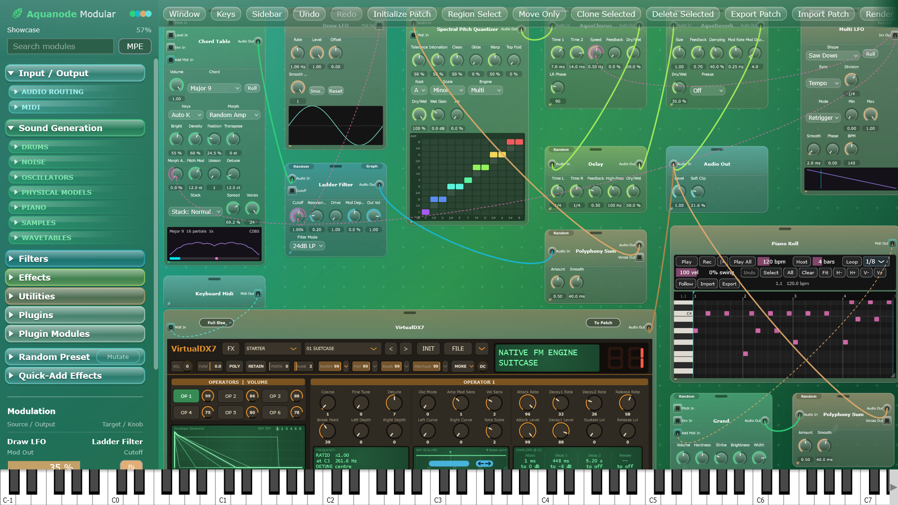

# Aquanode Modular

## Downloads

See the builds in the [Releases](https://github.com/aquanodemusic/aquanode-modular/releases) page. The current version is 7.0.0.

---

## Overview

**Aquanode Modular** is a free, versatile modular synthesizer written in JUCE/C++ precompiled for Android and Windows, in the form of both a VST3 plugin and standalone `.exe`, with an effect version, **Aquanode Modular FX**, also precompiled as a Windows VST3. Whether you want to load the VST3 version of Aquanode Modular inside your favourite DAW or use the DAW-functionalities of Aquanode Modular to host external VST3 plugins, or any combination in between, is completely up to you.

Inspired by classic hardware and digital modular environments, Aquanode Modular is an experimental playground to place modules, drag patch cables, and build complex sounds out of simple blocks. Other synthesizers and effects of mine, such as Phizmo or VirtualDX7, are built in as plugins, each playable with its own interface or taken apart into modules.

It works entirely offline without update checks, sign-in or downloaders. The Android app doesn't even ask for the internet permission.

The complete source code is available fully in this repository without any third-party repositories (except of course JUCE itself) and can be used to compile Aquanode Modular for any platform supported by JUCE, such as Linux as well.

### How to use Aquanode Modular

Aquanode Modular consists of four central elements: 
- A sidebar where you can have a look around all included modules and plugins. Tap one of them twice to load them into the patch area.
- A top bar with useful functions, such as saving / loading patches, showing / hiding the sidebar or keyboard, changing the look and feel of the plugin and so on.
- A piano roll with a toggle to resize it.
- A patch area where your actual patch, a collection of modules and plugins connected by cables, lives. 

Modules are simple audio building blocks. A sound generator, effect, or Midi / Automation utility usually comes in the form of a **module** (or module card). A **patch** is a connected set of modules. A **plugin** is a more sophisticated bunch of modules hidden behind a graphical user interface. In most cases, you can turn a plugin into a patch or part of a patch, using a button in a plugin's header.

The general idea and patch workflow is that you connect some optional MIDI or Automation Utility modules to your sound generation modules, add some effects after them, and everything finally goes into an Audio Out module to send the sound out of the plugin to make it audible. Many user friendly enhancements exist, for example simply dragging one module over another will, if they are compatible, automatically connect them with a cable, as drawing a cable from one module's output into another's input can be a bit finicky if the modules are placed far away or the patch is not zoomed in. Click a cable twice to delete it, or select a module or cable and press Delete. Triple-click a module to clear its self-feedback cables.

Round sockets carry audio, square ones modulation, rounded squares with a cyan ring MIDI. Inputs are on the left, outputs on the right. One output can feed many inputs, and several cables into one input are mixed. Any module card's knob can be modulated when you drag a cable from an output onto it. A ring around a modulated knob shows how far it can move. The **Modulation** table at the end of the sidebar lists every knob cable with its amount, where bipolar swinging can be activated.

### Features

Aquanode Modular's versatility comes from a large amount of well-rounded modules (currently 215, plus the plugins' own modules, minus one on Android which has no VST3 import module) from the combination of sound generators such as Chord Wavetable Synthesizers, physically modelled Pianos and Granulators as well as effects such as Cepstral Impulse Response Generators, Dub Delays, Resonators and Pitch Quantizers in combination with a modular setup where you can freely link all these modules in any order you desire. A Random Plugin Preset module builds a preset from scratch using predefined categories for a quick-start into sounddesign.

On top of that, it allows for Feedback Loops where you can route the output of an effect back into itself or somewhere earlier in the patch - something that many other plugins don't allow you to do as it *can* produce loud volume spikes, however the sounds you can get out of this are special: For example, a feedback loop of a Pitch Shifter and Reverb gives you a shimmer reverb without Aquanode Modular having a shimmer reverb module by itself.

The mutator mode in the top bar wiggles all available knobs by an amount you choose (never the cables or the output level), stores two states A and B and breeds them. Each card also has its own **Random** button that mutates only that card and can be reverted, to experiment with small changes to a patch with a "biological" touch.

This feature set is rounded off with Microtuning and MPE capabilities, the latter also simulated on Android, and custom colorways and designs for the UI, like a skeuomorphic or glassy hardware look. For MPE (MIDI Polyphonic Expression) exists a toggle near the search bar to activate. Then, every finger on the on-screen keys (or every note from an MPE controller) can slide sideways to bend a note, move up and down for Slide (CC 74), and add pressure (on Android only when the screen reports it). The MPE module from the sidebar turns each note's Slide, Pressure and Bend into cables.

Patches can be saved as `.aqua` files that contain the full setup you wired and set. The plugins inside Aquanode Modular can, in most cases, save their own preset as well.

### Changelog

Aquanode Modular contains almost all plugins from my earlier [aquanode-plugins](https://github.com/aquanodemusic/aquanode-plugins) repository shipped right in the plugin, so you do not need to download them individually. Aquanode Modular thus is intended as a replacement of all the individual plugins available in that repository, now inside a single, clean modular environment. Besides that, the updated version of Aquanode Modular also includes:
- **Import of external VST3 plugins**, both synths and effects, using the VST3 module (not in the Android version, as VSTs are not compatible with Android),
- physical modelling sound generators from both electric and acoustic pianos to orchestral instruments,
- more plugins like ROMpler-inspired synthesizers, classic semi-modular analog VCO synths and wavetable synthesizers,
- the Vita plugin, a port of Vital, updated, cleaned, and even available in the Android version,
- a 303-style bass line synth fitted to recordings of the original hardware, 
- cepstral drum morphing,
- a preset cloud visualizer for all build-in presets and preset morphing module,
- blooming midi chord pattern generators,
- creative filter effects like filtering a sound using the spectrum of another sound,
- the **Fruit DAW** plugin to have a complete DAW as a plugin or four-module patch (channel rack, piano roll, playlist and mixer) inside Aquanode Modular,
- **Fruit Arranger** which automatically maps independent pianoroll-synth-effect lanes from your patch itself to a track overview,
- the capability of loading Aquanode Modular inside Aquanode Modular (5 times deep),
- Microtuning and thorough MPE capability with a MPE-piano roll where you can draw note pitch bends directly,
- Latency reporting and optional internal latency compensation over the whole patch,
- a module search bar, more designs and colourways, plugin window and graphic piano roll resizing, as well as
- more presets and random preset generators.

---

## The full list of the codebase structure, modules and plugins

Click on a heading to open it. All in all there are 215 modules and 45 plugins, whose patch versions add 188 plugin modules (each named *Plugin - Part* in the sidebar).

<strong>Codebase</strong>

| Folder | Contents |
| :--- | :--- |
| `Source/Engine` | The audio processor: audio callback, voices and MIDI, patch building, cable graph, saving and loading, undo, Render to File, MTS-ESP, the Mutator. |
| `Source/Editor` | The interface: window and top bar, patch canvas, module cards, sidebar, colour panel, Mutator, Modulation table, on-screen keyboard. |
| `Source/Modules` | Every module, in folders named like the sidebar. `Core` has the base classes and the module list (`ModuleRegistry.cpp`), `Shared` the shared DSP. |
| `Source/Platform` | Android only: the system file picker and document folders. |
| `Source/Plugins` | The built-in plugins' card wrappers and patch versions, the plugin catalogue and the VST3 host. |
| `Source/PluginSources` | The plugins' own sources, with the small changes needed to run inside Aquanode Modular. |
| `Source/Presets` | Random Preset and Add Effect: the engines, genre recipes, DX7 voice generator and hand-made presets. |
| `Source/Resources` | The Aquanode Modular Logo / Icon. |

<strong>Sound Generation (52)</strong>

| Module | Description |
| :--- | :--- |
| 303 | Bass line synth fitted to recordings of the original hardware. Plays from MIDI (Free, Mono with slide, Poly) or its own 1-4 bar pattern grid, with RANDOM hooks (arps, octaves, acid lines, ambient drifts). |
| 808 | The 808's sixteen voices on 4 x 4 pads, modelled and fitted to recordings of the machine at every knob setting; its own Tone, Decay, Snappy and Tuning plus three knobs on the model per pad. |
| 909 | The 909's voices on 4 x 4 pads, modelled and fitted to recordings of the machine; any of its 71 fitted sounds on any pad. |
| Additive | Draw up to 64 harmonics, shaped by Tilt, Odd/Even and Stretch. |
| Analog | The FM Oscillator with per-voice drift, random phases and up to 7-voice unison. |
| Bowed | A bowed string (bow between bridge and neck, stick-slip friction) or a clarinet (reed and bore) that sustains while a key is held - straight from MIDI, nothing to patch; velocity sets the bow speed, aftertouch (or MPE pressure) leans into it. |
| Chord Table | Generated chord wavetables with 16-voice chord-stacked unison and spectral morphs. |
| Acoustic Guitar | A physically modelled steel-string guitar (six strings into its body's air and top resonances) fitted to recordings, with strumming, palm mute and breath control. |
| Cello | A physically modelled solo cello: a bowed string fitted to recordings through 157 measured body modes, Legato with glide, Pizzicato, Arco Studio, Pizz Studio, Pizz Mellow and Pizz Modal (a pizzicato rebuilt from a measured cello's partials), breath control. |
| Clap | Analog clap from three noise bursts and a tail; Model Snappy (a tight clap) and Clack (a bright crack), measured from a drum track. |
| Clarinet | A physically modelled clarinet (reed, bore, tone holes, register vent, bell) tuned and voiced against recordings, Legato or Poly, breath control; Voicing Refined, Original or Studio. |
| Drum Pads | Sixteen pads for your own drum sounds, with Level, Pan, Tune, Decay, Tone and choke groups per pad; the sounds are saved with the patch. |
| Drawbar | A tonewheel organ in the B3 manner: nine drawbars, percussion, key click, leakage, vibrato / chorus and a built-in Leslie (Stop / Slow / Fast, the mod wheel switches; Slow RPM, Fast RPM and Inertia), fitted to a recorded organ; MPE. |
| Droplets | Random sine pings following real bubble acoustics, a stream for every held key - tuned to the key played (By Key) or to the drop's size. |
| Dual VCO | Two engines. Synth: a two-oscillator analog polysynth with 20 presets from Init and the bright 808 State-style 7th Lead to pads and basses; VCO drifts freely like old hardware, DCO stays in tune. Oscillators: two panel-style VCOs and a mixer, ungated, for building the voice yourself. |
| Soft Pad | A pad for the mood: drifting sines with a whisper of soft organ and tine, playing quartal and pentatonic chords by itself; very quiet by design. |
| Summer Winds | Wind bells modelled on a recorded set, played by gusting wind or the keys. |
| Electric Piano | A tine piano, modelled (hammer, tine and bell, magnetic pickup, felt, damper, pedal), with Tone, a warm tube Drive, a phaser and the Suitcase's stereo vibrato; three Engines: Classic, Mellow or Studio. |
| Electric Guitar | A physically modelled electric guitar (six strings, a magnetic pickup, an oversampled amp and cabinet) fitted to recordings in five styles from Clean to Lead, with strumming, palm mute and breath control. |
| Formant | Singing oscillator morphing through the vowels A-E-I-O-U. |
| Formant FM | Singing, speaking and whispering FM: eight voiced formant operators and eight noise formants, drawn and dragged on the card, Formant Sequences through vowels and consonants, Ensemble, Presets. |
| Grand | The piano model as a concert grand with sympathetic strings, mics and lid, in two voicings (Felt, Clear). |
| Granulator | Granular sampler with a cloud of pitched grains per note; Grain Atk / Rel shape each grain's fade. |
| Hats | Analog hi-hats from six detuned squares; Decay goes from closed to open; Model Snip (a short bright snip measured from a drum track). |
| Kick | Analog kick with a pitch-drop envelope and drive; Model Snap Kick (a kick-clap measured from a drum track). |
| Modal Drum | Physically modelled percussion, from marimba to bell. |
| Multi Sample | Up to eight audio files played side by side, with a Track knob for which one goes out (or all). |
| Noise | White or pink noise per voice. |
| Oscillator | The core polyphonic FM operator with FM In and Env In. |
| Phase Distort | Phase-distortion oscillator; DCW morphs the wave without moving the pitch. |
| Piano | Real-time physical piano model in three voicings: Felt, Mid and Hard. |
| Pluck | Karplus-Strong plucked string, or Model Harp: a concert harp string fitted to a recorded harp. |
| PWM | Polysynth VCO with PWM and a square sub-oscillator. |
| Random Plugin Preset | One of the synth plugins (AlphaBeta, Aquanova, Aqua Vibrio, Massif, Phizmo, Reflex, Tidebreeze, VirtualDX7) playing a preset its own generator rolled: pick the Plugin, its Engine (Native or Original, for AlphaBeta and Aqua Vibrio), the Kind of preset (Anything by default) and, for Massif, a Genre; Apply rolls one. Plugin Window shows it in the plugin's own window, Save Preset writes it as the plugin's own preset file (.massif, .abpreset, .aquanova, .json, .phizmo, .xml, .tidebreeze, or a single-voice .syx for VirtualDX7), Open in Plugin puts the plugin itself with this preset in the module's place. VirtualDX7 always uses its built-in engine and picks from the built-in FM voices of the FM row. The patch keeps the plugin's whole state, so it plays the same preset when reopened. |
| Raw Data | Any file read as sound (Encoding, Byte Order, Channels, Start Offset, Amount, Sample Rate, Detect, Import), played like the Sampler. |
| Resynth Piano | A piano rebuilt from 33 recorded notes as partials, hammer samples and noise (no recordings inside, 1 MB). |
| Sampler | Keyboard-mapped sample player with a zoomable waveform; Save Sample writes the chosen interval played at any key (Save As -36..+36 st) as FLAC or WAV. |
| Snare | Two shell tones and a noise burst for the wires. |
| Super | A supersaw designer: seven saws in two designs (A, B) with Morph between them, the classic late-90s layout to start from, a tracking high-pass, a filter, Chord and an arpeggiator with Latch. |
| Growl | Bass growls for colour bass: six formula wavetables and a Custom one made on the card (Generate, Iterate through sweeps, Capture, Resample), a synced LFO and envelope to table / vowel / cutoff, a vowel filter, drive and a built-in three-band upward / downward squash; twelve held presets and eight one-hits; MPE. Recommended: Use Spectral Pitch Quantizer with this or similar Pitch Locking effects. |
| Strings | A physically modelled string section: every note played by up to eight players with their own tuning, vibrato and entry, across the stereo field, Arco or Pizzicato (each also as Studio voicings, and Pizz Modal from a measured cello's partials), breath control. |
| Spectral Resynthesis | A sound taken apart by the FFT and played from the keys: time-stretch, freeze, and spectral editing by region or by note, drawn on its spectrogram. |
| Transwave | Wavetable oscillator generated from a seed and one of twelve archetypes. |
| Unison | Up to nine detuned, panned copies of a note. |
| Warp | Band-limited morphing oscillator with seven phase warps, 16-voice unison and a Random Amp spectral morph. |
| Wavefold | West Coast-style FM into a wavefolder, no filter. |
| Wavetable | Scans a sample as single-cycle frames. |
| Wind | Physically modelled flute, pan flute and clarinet; aftertouch (or MPE pressure) blows harder. |
| Drum Morpher | Four drum sounds at the corners of a square, and the cursor anywhere in it plays a new drum made from them: lined up at their attack, decay and end, their cepstral tone shapes and pitched partials blended. |
| Random Preset Cloud | The synth plugins' presets as a map of coloured dots, similar sounds close together - tap one to play it. |
| Sitar | A sitar, physically modelled: a wire-plucked string on the broad, curved bridge (jawari) that makes it buzz - the louder the swing, the brighter, so the bright formant sweeps down through every note - with eleven sympathetic strings. |
| Aqua Drumkit | The drum modules' nine engines on a 3 x 3 kit: Kick and Snap Kick, Snare, Clap, Snappy Clap and Clack, Hats and Snip Hats, and the Modal Drum (its Tune sets its pitch here). |
| Sync Osc | Hard sync: a master oscillator at the key's pitch restarts a second one, the slave, at each of its cycles. |

<strong>Plugins (45)</strong>

| Plugin | Kind | Description | Patch version |
| :--- | :--- | :--- | :--- |
| **Additive Keys** | Synth | An additive synth with 63 harmonics per source drawn as bars, four envelope groups, a formant filter with vowel presets, 20 factory sounds and a preset roller in 12 kinds (Bell, Organ, Pad, Strings, Brass, Choir, Bass, Pluck, E-Piano, Lead, Glass, Sweep), every roll matched in loudness. | Synth |
| **AliasSynth** | Synth | A synth without any anti-alias, frequencies folded around a Nyquist limit of your choosing (or held at that rate, S&H), with a sine FM modulator, a wavefolder, bit reduction, glide and an ADSR. | Oscillator |
| **AM-20** | Synth | A polyphonic remake of a classic 1978 semi-modular monosynth, modelled from measurements of its software version. Two VCOs, resonant filters and a patch panel. *Save* / *Load* its own `.am20` presets or the original's `.fxb` or `.fxp` banks and patches (without the effects section of newer versions of the original). | Synth |
| **AlphaBeta** | Synth | A tribute to LinPlug's **Alpha 3**: its liquid filter and chorus, the CRT matrix and its randomizer, and an Original engine modelled on FreeAlpha 3.3. Loads `.abpreset` and the original's `.fxp` / `.fxb`. LinPlug as a company is no longer around, thank you for a wonderful synth. | Oscillator, Balance & Drive, Filter, Envelope, LFO, Mod Matrix, Amp, Chorus, Output |
| **Aqua Vibrio** | Synth | A close Virus/Viper-style synth. Aqua Vibrio's *Original* engine loads `.mid` / `.syx` and `.fxb` banks and can use a folder of the hardware's sampled waves. | Voice, Effects |
| **Aquanova** | Synth | A loose Supernova-style synth: three oscillators, the oscillator and filter matrices, the 42-band vocoder and the effects. | Oscillator, Noise, Ring Mod, Mixer, Filter, Amp, Envelope, LFO, Vocoder, EQ, Distortion, Comb, Chorus, Delay, Reverb, Effects Mix, Panner, Output, Arpeggiator |
| **AudioStretcher** | Synth | Stretches a loaded audio file in time and pitch independently using the Rubberband Library. | Player |
| **CombWeave** | Synth | Two banks of up to 128 sine partials on every note - spread linearly, exponentially or as harmonics, folded back or note-locked - each with its own envelope and high-pass. | Comb Osc, Output |
| **Cove Groove** | Synth | Generates noisy hardgroove loops: eight drum lanes with ten fitted sounds each, three drum-machine voices (808, 909, 707 recipes fitted to the machines' measured envelopes and spectra), eight physically modelled kits (808 and 909 fitted to recordings of the machines, Classic, Electro, Large Drums, Metal, Orchestral, World) with a tweak row for the model and a view of each lane's loudness, and your own samples (beside a lane's name), five groove styles, GENERATE / RND, 35 presets, kits, and a phaser, moving band-pass, delay and drive. It follows the DAW's transport or runs on its own tempo. | Sequencer, Kick, Bass, Clap, Closed Hat, Open Hat, Cymbal, Perc, FX Hits, Bus |
| **FM12** | Synth | A 12-operator PM/FM synth with a modulation matrix, user waves (saved with the patch and its presets) and a stereo chorus. | Synth |
| **Frequency Drawer** | Synth | A drawing synth: Paint on the canvas and it plays left to right. It renders in the background, keeps the drawing in the patch and exports it as FLAC. | *GUI only* |
| **GrainFreeze** | Synth | A phase-vocoder player. Load a sound, stretch it in time or freeze it on one spot (Spectral or Cepstral, with glide), scrub its waveform. Keys play it pitched from C4. | Player |
| **Massif** | Synth | A close model of a classic 2000s big-wavetable synth, modelled from measurements. *Wavetables* loads a zip of your wavetables as it is (or a folder of them); tables without a file play generated stand-ins, its *WT GEN* page writes new ones, and each oscillator's *Load* button takes any table file (WAV, FLAC, AIFF, Ogg). *Save* / *Load* are Massif's own presets: a `.massif` file holds every setting and, in its `samples/` folder, the tables the oscillators play (a generated one as its recipe), so a preset sounds the same without your wavetable folder. *Import* / *Export* are the original's `.nmsv` sound files. It comes with its own built-in sounds and a patch generator (pick a genre and a sound type - bass, lead, pad, keys, sequence, effect, dub techno chord - and press Generate). Its metal and glow colours can be chosen by tapping its name. Plays MPE (per-note bend and pressure). | Voice, Effects |
| **Phizmo** | Synth | The four-sound transwave synth: two transwave oscillators per sound, the arpeggiator, insert effects, a global reverb and performance macros. Its logo (or its RANDOM badge) rolls presets in eight styles. | Sound, Voice, Osc, Filter, Ring, Bus, Insert FX, Reverb, Output |
| **PhizmOsc** | Synth | A smaller two-oscillator transwave synth with its evolution envelopes, filter, chorus and reverb. Presets carry their wavetables with them. | Transwave Osc, Scanner, Mixer, Voice Filter, Bus Filter, Envelope, Pitch Env, LFOs, Voice Bus, Chorus, Reverb |
| **Reflex** | Synth | A close remake of a classic 2000s three-oscillator VA synth with its arpeggiator, trance gate, delay and reverb; it loads the original's `.fxb` / `.fxp` banks and has its own randomizer and mutator. | Voice, Effects |
| **SampleField** | Synth | A field of samples: every held key plays them one after another at random, with random pan, rate and level, a time limit and an echo per voice. | Field |
| **Slicer** | Synth | The drum slicer: load a loop, it finds the hits and lays one slice on each key from C1 up, with reverse, loop and mono. | Slice Player |
| **Soundscape Ecology** | Synth | The procedural nature synth: three slots of Biophony, Geophony and Anthrophony models with weather, time of day and stereo placement. | Slot, Field, Gate, Climate, Habitat, Output |
| **Tabla** | Synth | A physically modelled tabla: the bols sit on the keys from C3 up, and the two drums can be clicked or dragged (Slide Mode bends the pitch like a palm on the skin). | Bayan, Dayan, Output |
| **Tidebreeze** | Synth | A 2000s ROMpler-style synth whose waves are all generated, not recorded: 35 factory waves (airy voices, flutes, strings, bells, organs, surf, whale song ...), 39 presets, two layers, an arpeggiator and 17 effects. **ROLL** rolls new presets by category, **ROLL WAVE** new waves, and **LOAD FILE** turns your own audio into a wave. | Wave, Envelope, LFO, Filter, Amp, Arp, Insert FX, Send FX, Output |
| **VirtualDX7** | Synth | The six-operator FM synth with two engines: its native engine, and the bit-accurate VDX7 emulation once you load your own DX7 firmware ROM. Loads any DX7 `.syx` bank. The native engine plays MPE (per-note bend and pressure). | Operator, Envelope, Pitch EG, LFO, Function, Chord |
| **Vita FX** | Effect | Vita's effects rack on its own: Audio In through its chorus, compressor, delay, distortion, EQ, filter, flanger, phaser and reverb in any order, with only Vita's effects page on the card. | *GUI only* (the patch version of Vita has every effect as a module) |
| **Vita** | Synth | Adapted from the Vital synthesizer by Matt Tytel, under the GNU GPL v3 (`Source/PluginSources/vita/VITAL_LICENSE`). Its bundled libraries (kissfft, concurrentqueue and others) carry their own licences. Vital's name, logo and everything online are removed. The card draws with `juce::Graphics` instead of OpenGL. | Voice, Osc, Sampler, Filter, Amp, Env, LFO, Random, Macros, Mod, Mono Voice, Mono Env, Mono LFO, Mono Random, Chorus, Compressor, Delay, Distortion, EQ, Effects Filter, Flanger, Phaser, Reverb, Output |
| **NoteAdder** | MIDI | Adds notes around the ones you play - manual, scale and custom modes, animation, humanize and decay. | Note Filter, Chord, Transpose, Manual Chord, Scale Chord, Per Note Chord |
| **83ChorusVerb** | Effect | VirtualDX7's effects as a rack: Chorus, Delay, Phaser and Reverb (with Freeze), each with its own switch. | Chorus, Delay, Phaser, Reverb |
| **AlphaBetaFX** | Effect | AlphaBeta's drive, liquid filter and chorus as an effect, in both models (Native and Original). | Filter, Chorus |
| **AutoMorphEQ** | Effect | Seven bell filters, each morphing on its own between a start and an end frequency and level in one of seven shapes. | Band, Output |
| **Bandpass Modulator** | Effect | A moving band-pass in the style of an FL Patcher patch: the band steps through its range at a tempo division (eight modulation types), with distortion, an echo, autopan and skew. **Note Lock** keeps every step on the notes you light up, **MIDI Lock** on the notes you play, and the steps come from seeded random numbers, so a seed always moves the same way. | Effect 
| **CenterComb** | Effect | Up to 129 bell filters mirrored around a centre frequency, with Mirror / Wrap modes and smoothing. | Comb Bank |
| **EcoSee** | Effect | A spectral / cepstral analyser for bioacoustics with a build-your-own 3D view, made with bird calls and field recordings in mind. Audio passes through unchanged. | *GUI only* |
| **FlowEQ** | Effect | Three bell filters whose frequency, gain and Q follow hand-drawn curves (or wavetables), with gesture recording straight from the graph. | Bell, Flow Curve |
| **FullFilter** | Effect | Up to 128 bell filters on the harmonics of the played note, up to twelve notes at once. | Bell Bank |
| **Phorest** | Effect | The deep phaser: up to 48 allpass stages swept by seven LFO shapes (or by hand), with feedback, stereo offset, detune and Dry Cancel. | Phaser |
| **PrecisionUtility** | Effect | The channel utility: up to 10 s of latency, a blendable polarity invert, a volume per channel and stereo placement of each input. Bit for bit transparent at its defaults. | Utility |
| **Resonate** | Effect | The seven-voice tuned resonator with four engines (Modelled, Native, Crisp, Dark), which keeps its tuning when you switch between them. Notes on MIDI In retune it. | Bank |
| **SpectralCompare** | Effect | A live spectrogram with the Side In laid over it, a delta view and spectral EQ drawing. | *GUI only* |
| **SpectralCompress** | Effect | A spectral OTT-style compressor with a drawable target curve. | *GUI only* |
| **SpectralFilter** | Effect | Draw per FFT bin a gain (+-24 dB), a phase turn, a frequency shift and a pan over the live spectrum, each with Strength, Shift and Auto scrolling, a Frequency Window and Export IR. | Curves |
| **SpectralStereoize** | Effect | Draws the stereo width per frequency, from mono to extra wide. | Width |
| **Springer** | Effect | A spring reverb of up to seven coupled coils, from dub springiness to phasing laser sounds; its patch version lays the coils out as a ring you can re-patch. | Coil, Output |
| **TapElectric** | Effect | Tape deck character: electric hum with six harmonics, shaped tape noise, drift, wobble and saturation. | Hum, Tape Noise, Tape In |
| **Vocode** | Effect | A filter-bank vocoder with up to 256 bands; **Width** goes from narrow ringing bands to wide washy ones. | Vocoder |
| **Aquanode Modular** | Workspace | Loads a whole second Aquanode Modular onto one card, with its own patch, sidebar and Random Preset. It can go five levels deep. | *GUI only* |
| **Fruit DAW** | Workspace | An FL-style song arranging workspace on one card, in four windows, every sound running on its own inner Aquanode engine. **Channel rack:** 99 lanes for any synth module or synth plugin; tap a lane to load or open it, long-press to replace or remove it. **Piano roll:** 99 patterns, any lane in any pattern, with **Rec** to play notes straight in on a 1/16 grid. **Playlist:** 99 tracks for patterns and audio samples (up to ten minutes, with tempo detection and stretching to the song's tempo), a loop region that **Save Region** exports as a seamless FLAC, and **Knob Record** clips that move any knob along a drawn curve. **Mixer:** 99 inserts and a master, each with up to 10 effects, fader, pan, polarity inverter, a latency readout and up to nine sends (a send at 0 % is a sidechain only).Render to File plays the song too. **To Patch** splits the four windows into four separate cards, handy on a phone. | the four windows as four cards |

<strong>Effects (56)</strong>

| Module | Description |
| :--- | :--- |
| 3-Band Compressor | Upward and downward compression in three bands. |
| ADSR Delay | Delay with a shapeable envelope per repeat. |
| Align | Sub-sample delay, volume and polarity per channel. |
| AquaChorus | Liquid chorus / flanger. |
| AquaReverb | 8-line FDN reverb with Freeze. |
| Band Splitter | Splits audio into 2 - 7 bands (Linkwitz-Riley, summing back flat). |
| Bitcrush | Bit-depth reduction. |
| Chorus | Stereo chorus. |
| Circulator | Deep phaser of up to 64 allpass stages around a centre frequency, note or played key, with focus, feedback, spread and stagger. |
| Clip Drive | Clipper that folds back the detail it cuts, so transients survive. |
| Clip Preserve | Nothing clipped away: what would pass 0 dBFS (or the Ceiling) is mirrored back down or wrapped round from the floor, again and again however loud. Anti-aliased. Its Graph shows the spectrum or the waveform (Wave: the input times Drive against the Ceiling lines, and the folded output). |
| Compressor | Stereo-linked compressor. |
| Convolver | Loads any impulse response file (reverb, cabinet, anything) and convolves with it, true stereo; Length, Reverse, Normalize, Pre-Delay, cuts, Width. The IR is saved in the patch. |
| Delay | Tempo-synced stereo delay. |
| Drive | Tube, tape, fuzz or crush distortion with auto gain. |
| Dub Echo | Two-head tape echo modelled on measurements of a classic dub box: dark, saturating repeats, wow, flutter and tape noise, runs into self-oscillation, with the playback hiss like that of a RE-201 and Echo Noise recorded into the repeats. |
| Tape Echo | Dusk Audio's Tape Echo 2: a component-modelled three-head tape echo with a spring reverb, 12 head and spring modes, a motor that glides, Intensity into self-oscillation, Bass / Treble on the echoes, Wow & Flutter, Tape Age, Noise, Sync to the patch's tempo. |
| Echo | Tape-style delay with wobble. |
| Ensemble | Chorus, phase and three-phase ensemble. |
| FET Compressor | A FET limiting compressor: Input into a fixed threshold, Output, Attack 20 to 800 microseconds, Release 50 ms to 1.1 s, Ratio 4, 8, 12, 20 or All (every button in: the curve turns over and it smashes, dirtier). The FET adds second harmonic as it works. Mix, Side In; a needle meter shows the gain reduction. |
| Flanger | Classic flanger. |
| FM | Cross-modulates two signals. |
| Free Delay | Any delay time from a fraction of a sample to 10 seconds, from combs to echoes. |
| Granulation | The Granulator's engine as a live effect. |
| Impulse Response Foundry | Turns a recording or file into an impulse response and convolves with it. |
| Limiter | Zero-latency peak limiter. |
| Noise Exciter | Band-passed noise that follows the sound - bright crunch on a sub bass, air on a pad, not distortion: Follow (envelope or waveform), Squash (OTT-like evening out), Freq (1 kHz by default), Width, Track. |
| Opto Compressor | An optical leveling compressor: smooth, slow to grab, with a release that remembers (after a short peak it lets go quickly, after long hard compression half goes at once and the rest drifts back over seconds). Peak Reduction, Compress (about 3:1) or Limit (about 10:1), Emphasis for the sidechain's highs, Gain through a gentle tube-like stage, Mix, Side In; a needle meter shows the gain reduction. |
| Phaser | 2-12 stage phaser. |
| Resonator | One resonator with all of Resonate's engines. |
| Reverb | Algorithmic reverb. |
| Reverser | Plays each window (1/2 to 1/32 bar, or free ms) backwards, smoothly crossfaded; its latency (one window) is reported. |
| Rotary | Rotating speaker cabinet: drum and horn with their own speeds and inertia (Stop / Slow / Fast), throb, width and the horn's Doppler. |
| Sidechain Comp | Ducks the input by the level of Side In. |
| Sine Filterbank Retuner | A bank of band-pass filters whose levels drive sines (an additive resynthesis), retuned by a note matrix or by MIDI - every partial pulled to the nearest allowed note. |
| Smooth Hall | Smooth FDN hall. |
| Spline Folder | A wavefolder you draw: points joined by a smooth spline or, with Curve Linear (or Tension 0), straight lines (piecewise linear), and any point can hold a jump, a discontinuity for wraps and steps. Drag points, double-tap to add or remove, hold a point for a jump; Shapes has ready folds, steps, wraps and random curves, and Make Odd. Outside folds, wraps or holds what passes the edges. Anti-aliased (the spline's exact integral), DC-blocked; Bias In sweeps the fold. |
| Shimmer Reverb | Bloom Reverb with a pitch shifter in its feedback: the tail climbs (or sinks) an interval with every pass; Shift -24..+24 st, Cents. |
| Spring Reverb | Physically modelled spring reverb fitted to measured tanks: the Tank model's dispersive springs give the classic drippy chirps bending up to the springs' top end (Chirp Tone moves it, like a thicker or thinner spring), Blur Rate blurs the later passes into the wash, Drip adds the bright falling chirps; the older Coils model is still there. |
| SR Reduce | Sample-rate reduction. |
| Stereo Delay | Stereo / cross delay. |
| Stereo Phaser | Stereo phaser with resonance. |
| Stereo Width | Mid/side widener with bass mono. |
| Stutter | Catches a slice (1 bar to 1/64, or free ms) and repeats it while Stutter is on; Gate, Decay, Ramp (pitch per repeat), Smooth. |
| Tape Stop | The tape slows to a halt (Stop Time, Curve) and spins up again (Start Time) - an on/off for a lane or a button. |
| Tape Wobble | Wow, flutter, saturation and dropouts. |
| Vocoder | Classic vocoder. |
| Wah | Auto, LFO or pedal wah. |
| Waveshaper | Distortion with selectable curves. |
| Beat Repeat | Catches a slice on the beat and stutters it: every Interval (at the Offset sixteenth) it rolls Chance, then repeats a Grid-long slice for Gate sixteenths, each repeat Decay quieter and Pitch lower. |
| Multiband Delay | Three bands (Low, Mid, High, split where the X knobs say), each echoing on its own: its own time, feedback and level - a bass that repeats on the beat under highs that scatter. |
| Modal Body | Plays any sound into a resonating object: up to 24 tuned modes shaped like a bar, a plate, a drum skin, a glass, a tube or a wooden box. |
| Bloom Reverb | A reverb that opens like a flower: Bloom smears the sound through long diffusers before it reaches the room, so the reverb grows instead of answering at once. |
| Spring Tank | Four springs in a tank, after smiarx's AELAPSE: each a loop through a long chain of all-passes that turns every echo into the spring's chirp, the springs passing sound to one another on every round trip. |
| Nyquist Folder | A lower Nyquist for any sound, as FM12's Nyquist Limit: what lies above it folds back under it, mirrored. |
| Quadrature Stereo | Stereo that folds back to mono cleanly: left and right are the same sound 90 degrees apart at every frequency (two all-pass chains), so their sum keeps the same level everywhere - no comb filtering. |

<strong>Filters (27)</strong>

| Module | Description |
| :--- | :--- |
| 3-Bell EQ | Three bells on a draggable curve. |
| Bandpass | One band, Q 0.3 to 150, 12-48 dB/oct, its centre free or locked to the notes of a scale (with glide). |
| Bell | A single peaking band. |
| Center Comb | Peaking filters spread around a centre frequency. |
| Comb Filter | Delay-line comb that rings at a pitch. |
| Dual Filter | HPF into LPF with self-oscillating peaks. |
| Formant Filter | The vowel bank applied to any audio. |
| Highpass | 12 or 24 dB highpass. |
| Ladder Filter | Transistor-ladder filter with drive. |
| Lowpass | 12 or 24 dB lowpass. |
| Multimode Drive Filter | The AquaFilter plugin's core: a saturating ladder (12/24 dB, and a hotter 24+) and an SVF band/highpass, with Drive before it. |
| Notch | Narrow band cut. |
| Playable EQ | Up to 12 bell, band-pass or notch bands tuned to the notes you play (and their harmonics); MPE slides each peak with its note. |
| Pitch Lock Filter | Dampens every note not in the chosen pitch classes. |
| Resonance Suppressor | Finds and cuts resonances as they happen, with no latency; optional sidechain and a drawable sensitivity curve. |
| Shelf EQ | Low shelf, mid peak and high shelf. |
| SVF Filter | State-variable LP / BP / HP. |
| Tube Program EQ | A passive tube program EQ with its famous low-end trick: Boost and Atten at the same low frequency (20, 30, 60, 100 Hz) do not cancel, the very lows rise with a bump and a dip opens right above (at 60 Hz, both at 5: about +3.6 dB at 48 Hz, -2.7 dB at 110 Hz). A high boost bell (3 to 16 kHz, Bandwidth sharp to broad) and a high attenuation shelf (5, 10, 20 kHz), a tube make-up stage, Output, EQ In/Out. Its curve shows from the start, worked out from the very filters it runs. |
| Warm Ladder | A warm 24 dB ladder. |
| Filter Table EQ | A wavetable of EQ curves: eight frames per table (vowels, dark to bright, petals opening, a walking comb ...), and Position glides through them - put an LFO or an envelope on Position and the sound's colour travels. |
| Equal Loudness | An EQ from the ear's equal-loudness contours (the Fletcher-Munson curves, as ISO 226:2003 has them), convolved as an impulse response. |
| Graphic 7 EQ | Seven filters, a dot for each on the graph: drag a dot sideways for its frequency, up and down for its volume, the wheel (or a right-drag) for its Q. |
| Ripple EQ | An EQ curve shaped like a wave packet: ripples that build up towards Center and die away again (Width octaves wide, Ripples per octave, Depth dB tall). |
| FM Filter | Two-operator FM whose spectrum is the filter: a carrier at Pitch and a modulator at Pitch x Ratio with Index - the curve has a peak wherever that FM tone has a partial, as tall as the partial is loud, Width cents wide, with Floor ... |
| Audio to Filter | The spectrum of a sound becomes the filter: every 2048 samples of Shape In are measured, and where that sound is loud Audio In passes, where it is quiet Audio In goes down (to Floor). |
| Tilt EQ | Tilts the whole spectrum around Pivot: Tilt dB per octave, + brightens (the highs up, the lows down), - darkens. |
| Pan Filter | Splits the sound with a filter - a band, the lows or the highs - into that part and the rest (the original with the part phase-inverted out), and gives each its own pan and level. |

<strong>Spectral (10)</strong>

| Module | Description |
| :--- | :--- |
| Pitch Shifter | Grain-based pitch shifter, ±2 octaves. |
| Cepstral Morph | Cross-synthesis: the carrier takes on the modulator's spectral envelope. |
| Spectral Delay | A drawn delay time per FFT bin. |
| Spectral Enhance | Pushes bins toward a drawn target curve. |
| Spectral Filter | A drawn per-bin gain curve. |
| Spectral Freeze | Freezes the sound in place. |
| Spectral Gate | Per-bin gate against a drawn threshold. |
| Spectral Morph | Morphs one spectral envelope toward another. |
| Spectral Pitch Quantizer | Polyphonic FFT pitch mapper modelled on measurements. Moves every partial to the note a 12 x 12 matrix says, with Dry/Wet, Wet Gain and Air. Root and Scale menus stamp the matrix with a scale (Major, Minor, the pentatonics, modes, Blues...). Three engines: **Multi** (the default) moves only the partials it can measure, lets notes from A#3 up carry their harmonics and leaves crowded tops, noise and drums as they are; **Mono** is denser, **Bright** is Multi plus a **Pass Quiet** (partials far under the loudest one stay where they are), **Flicker** (unsteadiness), **Snap** (notes whose pill is on their own row are tuned onto it) and a **MIDI In** whose held notes pass unquantized. |
| Spectral Difference | Two sounds in, their difference out, bin by bin: A - B is what A has more of than B (at A's phase), B - A the other way round, Both Ways wherever they differ (at the louder one's phase). |

<strong>Input / Output (4)</strong>

| Module | Description |
| :--- | :--- |
| Audio In | The host's audio input, with a level knob. |
| Audio Out | The patch's output, with Level and Soft Clip, an oversampled soft limiter that never passes 0 dBFS (off by default: turn it up for it, at 0.65 ms of latency). |
| MIDI Controls | Pitch bend, mod wheel, aftertouch, any CC and the sustain pedal as cables; sets the bend range. |
| MIDI Learn | One control of your MIDI controller driving any knobs across their range, like a Macro. |

<strong>Utilities (66)</strong>

| Module | Description |
| :--- | :--- |
| A/B Fader | Fade smoothly from A to B (the default), or at equal power (Equal Power, the Crossfade module's way), or listen to A, B or their difference - without clicks. |
| ADSR | Per-voice envelope. |
| Always MIDI | Holds one note forever so a generator drones. |
| Analog EG | RC envelope with delay and hold. |
| Arp | Arpeggiator with chance and ratchets. |
| Audio Thru | Passes audio unchanged, as a cable junction. |
| Automation Lanes | Four drawn or rolled automation lanes up to 8 bars, each with its own step, and every step its own shape (ramp, slanted ramp, stairs, sine, random, on/off, spline, draw); four outputs; from the sidebar optionally wired to four random effects. |
| Chord Name | Names the chord being played (keys or its MIDI In): Cmaj7, F#m7b5, Gsus4/D, with the notes and bass. |
| Clock | Tempo-synced pulses with swing. |
| Crossfade | Equal-power A/B mixer. |
| Curve CV | A drawn control curve, looped or one-shot. |
| Curve Env | DAHDSR envelope with curves. |
| DAW Mod | A host-automatable parameter as a modulation source (24 slots). |
| DC Blocker | Removes DC offset. |
| DC Offset | Shifts and scales a signal. |
| Discard MIDI | Blocks chosen note classes, or all notes; Global Mode keeps every played key to a key and scale. |
| Draw LFO | An LFO you draw by hand. |
| Env Follow | Turns audio into a modulation signal. |
| Euclid | Euclidean rhythm generator with chance and ratchets. |
| Fruit Arranger | The playlist of a song made in the patch: every piano roll with its synths and their effects is a numbered pattern; pills of patterns, knob automation (Modulate Parameter) and samples go on any track; only clean, uncrossed patterns play (what fails is crossed out); latency compensation inside, own transport or the host's. |
| Gate | 1 while a note is held. |
| Inspector | Measures any module's frequency response: one Inspector before it as the generator, one after it as the analyzer - magnitude and phase, with the latency found or set by hand. |
| KeyTrack | The note's pitch as modulation. |
| L/R Splitter | Splits stereo into left and right. |
| Latency | Delays a chain by milliseconds (to the hundredth) or by blocks, to line it up with another; reported to the host. |
| LFO | Per-voice LFO; free-running when it only feeds global modules (a 303 playing its grid, effects). |
| Logic | Boolean and comparison logic on gates. |
| Macro | One knob that turns many. |
| MIDI Add | Adds up to seven notes (a chord menu, Show Visuals for the keyboard); MPE notes keep their bend, pressure and slide. |
| Microtuning | Historical, world and equal tunings or a Scala file, for the whole patch or one MIDI chain. |
| Mixer | Four-channel mixer. |
| MPE | Each note's Slide, Pressure and Bend as cables; Ignore Default MPE Map makes what it sends into a synth replace that synth's own use of it; Slide > Wavetable sets how far Slide moves a wavetable position each way. |
| Multi LFO | Tempo-synced shape LFO with colour-bass shapes. |
| Note Random | A random value per note or per key. |
| Panning | Stereo balance. |
| Periodogram | x = frequency, y = amplitude. Up to three sounds over each other (Cyan, Pink, Yellow), or with Delta Yellow becomes Cyan minus Pink; Graph or Bars, Reassign for every partial at its true frequency, Speed from Very Fast to Slow, a faint slow Envelope (or Hold). The init patch has one listening to the output. |
| MPE Piano Roll | A looping roll of MPE notes drawn as lines in any direction (On Notes or Between Notes, a Slope for straight sweeps, A4 420 - 460 Hz), bent with Curve, joined with Join (line or spline), moved with Move, each with its own Pressure or Slide drawn in green; its MPE Out connects only to modules and plugins that play MPE (listed in its description; the plugins are Vita, Massif, VirtualDX7's native engine, AlphaBeta, Aqua Vibrio, AM-20, AliasSynth, Aquanova, Phizmo, Reflex, Additive Keys, FM12 and Tidebreeze). |
| Piano Roll | Resizable looping note sequencer, up to 256 bars, with MIDI file import/export and Rec for what you play. |
| Polyphony Sum | Scales the level to the number of voices reaching it so chords don't get louder. |
| Quantize | Snaps a pitch signal to a scale. |
| Random LFO | Smooth, stepped or chaotic random modulation. |
| Record | Records whatever reaches it; the take is saved with the patch. |
| Reroute Send / Reroute Return | Audio across the patch on eight buses, without a cable. |
| Ring Mod | Multiplies two signals. |
| S&H | Clocked sample & hold. |
| Skew LFO | Skew-morph LFO. |
| Slew Limiter | Limits how fast a signal changes. |
| Spectrogram | x = time, y = frequency, brightness = amplitude. Three inputs (Cyan, Pink, Yellow) whose colours add up like light, or with Delta Yellow shows where Cyan and Pink differ; Reassign on or off (Accuracy: how far a reassigned point may move and still be drawn, stricter the higher), Draw Sharp or Smooth, a faint slow average spectrum (Envelope) at the right edge. Decimate (Off by default) trades time for finer frequencies; Speed Lock keeps the scroll speed while it does. |
| MIDI Bloom | Lush chord progressions from one held note (it sets the key) or Autoplay, in eight characters from Mellow 7ths to Quartal & Penta; Extra Bass, Transpose; Rec to .mid. |
| MIDI Rain | Short notes falling around the played notes, moving as the Bandpass Modulator does, locked to pentatonics, held or chosen notes; Rec to .mid. |
| MIDI Stamp | Ready-made MIDI clips behind eight stamps (Pad, Chord Stab, Lead, Bells, Arp, Bass, Acid Line, Beat), varied each time; To Piano Roll, Save MIDI. |
| Step Seq | 16-step pitch and gate sequencer with chance and ratchets. |
| Tempo | The patch's tempo as a knob, so it can be automated; the top bar's BPM shows it and turns it (only shows it while the knob is modulated). Tempo Out gives a lane its own tempo (into Tempo Ins). |
| Text | A note on the patch: type anything, kept as typed in the patch and its presets. |
| Tuner | Shows the note, cents and frequency of the input. |
| Vector | Vector-synth joystick mixing four sources. |
| Velocity | Note velocity as modulation. |
| Volume | Level control with a modulation input. |
| VST3 Plugin | Loads one of your VST3 plugins into the patch, with its own window and a Block Size choice (32 samples by default; not on Android). |
| Waveform Viewer | An oscilloscope, no FFT: x = time, y = amplitude (+-1 = full scale). Up to three sounds (Cyan, Pink, Yellow), or with Delta Yellow becomes Cyan minus Pink; Time 0.5 ms to 2 s, Zoom, Trigger (Free, Rising, Falling) at Level holds a periodic wave still, Channel Mid / Left / Right, Freeze, Thru. |
| CPU / RAM | How much the patch costs. |
| XY | A pad for two sources: X is how much of A, Y how much of B - bottom left both silent, top right both full, along the bottom only A, up the left only B. |
| Super MIDI | Unison for any synth: each note played as several slightly detuned copies, as the Super oscillator stacks its saws. Only works when MPE is active. |
| Phase Inverter | The sound upside down: every sample times -1, on both channels. |
| Random Sweep | Sample and hold where each hold is a sweep: every step picks a new range (From, To) and a new speed, and an LFO sweeps between them at that speed until the next - sometimes slow, sometimes fast. |
| Audio LFO | An LFO from very slow up to audio rates (20 kHz): on a cutoff or a pitch it makes AM- and FM-like sounds. |

---

## Credits

Aquanode Modular was created with heavy assistance by Claude, the AI by Anthropic.

No Copyrighted Material ships with this plugin, everything is open-source. That said, a few of the plugins inside Aquanode Modular are more or less obviously modelled after other third-party synthesizers, but no reverse engineering or similar happened in the making of Aquanode Modular - only measurements and by-ear finetuning of the modules.

To the best of my knowledge, shipping Aquanode Modular in this state is fine: it contains no copyrighted material of others - no code, no factory presets, no wavetables or samples of the synthesizers it is modelled after. Their sounds and wavetables are only ever loaded from the user's own files.

The same goes for reading and writing preset files, loading sounds was not worked out by looking into the original's code (no decompiling or disassembling). It was tested from the outside, using licensed copies, saving sounds in the original with one setting changed at a time, comparing the saved files, and rendering and measuring the audio.

For example, this should be allowed in the EU by the Software Directive 2009/24/EC, which protects a program's code but not the ideas and principles behind it, including its interfaces (Art. 1(2)). A lawful user may observe, study and test how a program works to find those ideas and principles (Art. 5(3)), and any licence term that forbids this is void (Art. 8). Each country has this in its own law, Germany for example in §§ 69a-69g UrhG.

Product names mentioned in this README belong to their owners and only say what a plugin is modelled after.

- **Additive Keys** is loosely inspired by the Kawai K5,
- **AM-20** (AM simply as acronym for "Aquanode Modular") is modelled after the MS-20, measured from the outside only, one control and one patch cable at a time.
- **AlphaBeta** is a tribute to LinPlug's Alpha 3.
- **AudioStretcher** and Fruit DAW (stretching a sample to the song's tempo) use the **Rubber Band Library** by Breakfast Quay (https://breakfastquay.com/rubberband/), under the GNU GPL v2 or (at your option) any later version (`Source/PluginSources/audiostretcher/Rubberband/COPYING`).
- **Fruit DAW**'s look is inspired by FL Studio's design. FL Studio, my personal favourite DAW, belongs to Image-Line.
- **SpectralCompress** is inspired by the Spectral Compressor in [nih-plug](https://github.com/robbert-vdh/nih-plug) by Robbert van der Helm (no code taken).
- **Spectral Pitch Quantizer** follows the sound style of Pitch Quantizer Plugins like Pitchmap.
- **Tape Echo** is **Tape Echo 2 by Dusk Audio** (https://github.com/dusk-audio/dusk-audio-plugins): its DSP core, unchanged, under the GNU GPL v3 or later (`Source/Modules/Effects/Delays/DuskTapeEcho/NOTICE.md`). Thank you, Dusk Audio!
- **Spring Tank** is the spring reverb of **ÆLAPSE by smiarx** (https://github.com/smiarx/aelapse, its Springs processor in https://github.com/smiarx/dsp), carried over to scalar C++ under the GNU GPL v3. Thank you, smiarx!
- **Circulator**'s Engine called "Original" is **Circulate by GullDSP (Anis Dadou)** (https://github.com/GullDSP/Circulate-VST): its effect and all-pass carried over into the module, under the GNU GPL v3. Thank you, GullDSP!
- **VirtualDX7**'s VDX7 emulation is VDX7 by chiaccona, under the GNU GPL v3. It uses **libsamplerate** by Erik de Castro Lopo (BSD) and the **MTS-ESP** client library by ODDSound, whose licences are in `Source/PluginSources/virtualdx7/Source/External`. Thank you, chiaccona!
- **Vita's Aquanode Soundscapes** are presets by Aquanode; the remakes are crude remakes inspired by the named artists, not copies, and carry no audio of theirs.
- **Vita** is adapted from the Vital synthesizer by Matt Tytel, under the GNU GPL v3 (`Source/PluginSources/vita/VITAL_LICENSE`). Its bundled libraries (kissfft, concurrentqueue and others) carry their own licences. Vital's name, logo and everything online are removed. The card draws with `juce::Graphics` instead of OpenGL.

### Licence

Aquanode Modular (the synth, the FX version, the Android app and their source code) is licensed under the GNU AGPL v3, in line with JUCE’s open-source licence (see LICENSE). It includes Vita, adapted from Vital by Matt Tytel, VirtualDX7’s VDX7 emulation by chiaccona, the Tape Echo's DSP by Dusk Audio, the Spring Tank after ÆLAPSE by smiarx and the Circulator's Original engine after Circulate by GullDSP, all under the GNU GPL v3, and the Rubber Band Library (GPL v2 or later, used here under v3). Those parts keep their licence, which permits combining them with AGPL v3 code (GPL v3, section 13). You may use, share and change it under the same licence. If you build your own programs using code from this repository, please pass on the source code with it.
